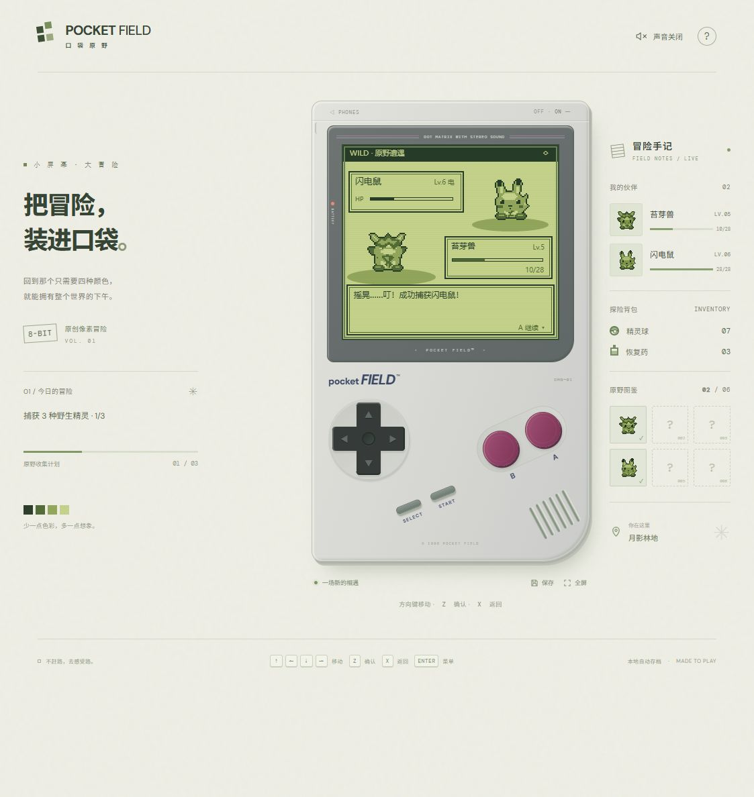

# Pocket Field · 口袋原野

一台可以在网页里玩的复古掌机，以及一场完整的原创像素精灵冒险。使用原生 HTML、CSS、JavaScript 编写，无需安装第三方依赖。



## 开始游玩

### 在线版

[打开 Pocket Field](https://ssgaryss.github.io/Pokemon/)

使用 GitHub Pages 托管。每次推送到 `main` 分支后，GitHub Actions 会先检查脚本并运行测试，再自动更新网站；部署状态可以在仓库的 **Actions** 页面查看。

### 离线版

下载仓库后，用现代浏览器直接打开根目录的 **PocketField.html**。这份单文件包含游戏所需的代码、样式、像素画与声音，无需服务器。

### 本地开发

需要 Node.js。克隆仓库后，在根目录运行：

```sh
git clone https://github.com/ssgaryss/Pokemon.git
cd Pokemon
npm run dev
```

打开 http://127.0.0.1:4173 。无需执行 npm install。

## 游戏内容

- 复古掌机机身、四色像素屏、实体方向键及 A/B 按键。
- 地图探索、人物对话、草丛随机遇敌、六种原创小精灵。
- 回合制攻击与特技、属性克制、捕捉、换队、恢复药。
- 免费恢复站：治疗伙伴，补足精灵球与药水；战败后安全返回。
- 捕获三种不同野生精灵后，挑战东北高台上的守林人，赢取徽章。
- 图鉴、队伍、冒险手记、自动存档与手动存档。
- 响应式布局、触屏按键、全屏、可开关的原创芯片音乐与音效。

## 操作

| 按键 | 功能 |
| --- | --- |
| 方向键 / WASD | 移动、选择 |
| Z / 空格 | A：确认、交谈 |
| X / Escape | B：返回 |
| Enter | START：菜单 |
| Shift | SELECT：图鉴 |

也可以点击或触摸机身按键。声音默认关闭，可在右上角开启。游戏进度保存在当前浏览器中，不同浏览器和不同网址之间不共享存档。

## 检查与构建

```sh
npm run check          # JavaScript 语法检查
npm test               # 十二项游戏逻辑与渲染测试
npm run build:offline  # 重新生成根目录 PocketField.html
```

已实际试玩地图移动、对话、背包、战斗和捕捉。测试涵盖地图连通性、收集与通关条件、捕获与队伍、道具消耗、战败恢复、存档恢复和各界面渲染。

## 目录

```text
Pokemon/
├── PocketField.html        # 可直接打开的离线游戏
├── make-offline.mjs        # 单文件离线版生成器
├── package.json            # 根目录开发、检查与构建命令
├── pocket-field-preview.png
└── pocket-field/
    ├── dist/
    │   ├── index.html      # 网页与掌机结构
    │   ├── style.css       # 外观与响应式布局
    │   ├── app.js          # 按键、触屏、手记与网页交互
    │   ├── game.js         # 地图、战斗、进度与存档
    │   ├── sprites.js      # 原创四色像素画
    │   └── audio.js        # 原创芯片音乐与音效
    ├── game.test.mjs
    └── server.mjs
```

`pocket-field/dist` 可部署到普通静态网站托管平台。所有像素素材均由代码绘制；开发版字体可联网加载 Google Fonts，离线版使用系统字体。
